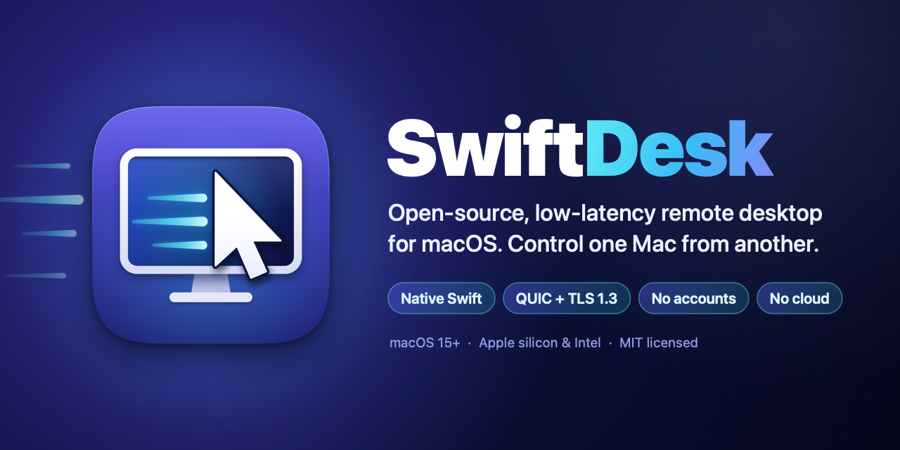
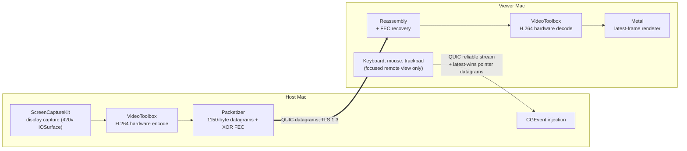

<h1 align="center">SwiftDesk</h1>

<p align="center">
  
</p>

<p align="center">
  <strong>Open-source, low-latency remote desktop for macOS — control one Mac from another.<br>
  Native Swift, no accounts, no cloud.</strong>
</p>

<p align="center">
  <a href="https://github.com/shivaluma/swiftdesk/releases/latest"></a>
  <a href="LICENSE"></a>
  
  
  <a href="https://github.com/shivaluma/swiftdesk/actions/workflows/ci.yml"></a>
</p>

<p align="center">
  <a href="#download">Download</a> ·
  <a href="#quick-start">Quick start</a> ·
  <a href="#features">Features</a> ·
  <a href="#how-it-works">How it works</a> ·
  <a href="#swiftdesk-compared">Compared</a> ·
  <a href="#roadmap">Roadmap</a> ·
  <a href="#faq">FAQ</a> ·
  <a href="#build-from-source">Build</a>
</p>

SwiftDesk is a **remote desktop for Mac** built only on Apple frameworks: ScreenCaptureKit for capture, VideoToolbox
for hardware H.264, Network.framework **QUIC** with mutual TLS 1.3 for transport, and Metal for display. The same app
can **share this Mac** (Host) or **control a Mac** (Viewer). Your Macs talk to each other directly, on your LAN or over
your own [Tailscale](https://tailscale.com) network. There is no sign-up, no ID server and no relay.

> [!NOTE]
> **Status: early (0.2.0), not production-ready.** The pipeline is measured on one Mac (numbers below), but
> **click-to-photon latency between two Macs has not been measured yet**, and several features are verified on
> loopback only. See [Verification status](#verification-status) and [Known limitations](#known-limitations).

---

## Download

**[Download the latest SwiftDesk DMG](https://github.com/shivaluma/swiftdesk/releases/latest)** — one universal app
for **Apple silicon and Intel** Macs, macOS 15 or later. Install it on **both** Macs.

1. Open the `.dmg` and drag **SwiftDesk** onto **Applications**. (Run it from Applications, not from the disk image:
   [Open at Login](#open-at-login) needs that.)
2. **First launch:** builds are not notarized yet, so macOS blocks the first launch ("cannot verify SwiftDesk"). Use one
   of these:
   - Open SwiftDesk once and dismiss the warning, then go to **System Settings → Privacy & Security**, scroll to the
     message about SwiftDesk, and click **Open Anyway** (confirm with your password or Touch ID).
   - Or, in Terminal:

     ```sh
     xattr -dr com.apple.quarantine /Applications/SwiftDesk.app
     ```
   - On macOS versions before 15, right-click → **Open** used to do this; macOS 15 and later require the
     *Open Anyway* button instead.

The disk image also contains `Read Me First.txt` with the same steps ([`scripts/dmg-readme.txt`](scripts/dmg-readme.txt)).

## Why SwiftDesk

- **Native, not a port.** SwiftUI, AppKit, Metal and VideoToolbox: no Electron, no web UI, no FFmpeg, no screenshot
  polling, and no third-party dependencies at all.
- **Built for responsiveness.** Every stage keeps only the newest frame; a late frame is dropped instead of queued.
  Input travels on its own QUIC stream and never waits behind video.
- **Private by design.** No accounts, no cloud, no relay servers. Frames, keystrokes and clipboard contents are never
  logged or stored.
- **Secure by default.** Mutual TLS 1.3 with pinned device fingerprints, and every session is approved on the Host
  (or unlocked with a password you set).
- **Open source (MIT).** Read it, build it, change it. A free, open **AnyDesk alternative** and **TeamViewer
  alternative** for people who only need Mac-to-Mac control.

## Features

**Streaming quality**
- **Sharp** (default): the Host display's native resolution, up to **1920×1080 at 60 fps**. **Balanced**: up to
  1280×720 for weak Wi-Fi.
- **Adaptive bitrate and resolution**: steps down 1080p → 720p → 540p → 540p at 30 fps when the link is congested, and
  back up after ≥ 10 s of clean network.
- **Forward error correction**: adaptive XOR parity rebuilds a lost datagram without a round trip; keyframe datagrams
  are sent twice.
- Hardware H.264 encode and decode with low-latency rate control; Metal rendering at one stream pixel per screen pixel
  (**Actual Size**, ⌘0).

**Control**
- Keyboard (with modifiers and held-key tracking), mouse, drag, and precise trackpad scrolling with momentum.
- **Remote pointer shape**: your local pointer takes the Host's cursor shape (I-beam, resize arrows, app cursors) and
  still moves instantly.
- **Send Keys** menu (⌘Tab, Spotlight, Mission Control, screenshots, Force Quit, Lock Screen …) and optional
  **system shortcut capture** so ⌘Tab and friends act on the remote Mac.

**Convenience**
- **Clipboard sharing** both ways: text, rich text, images and URLs.
- **Address book**: Favorites and Recent Hosts as cards with a thumbnail of the last session; one click connects.
- **Automatic reconnect** after Wi-Fi dropouts, without a second approval within 2 minutes.
- **Open at Login** and **password (unattended) access** for a Mac you reach remotely.
- **Bonjour discovery** of nearby Macs, and **Tailscale address detection** with a direct/relay path indicator.
- Live diagnostics: RTT, FPS, bitrate, loss, decode→present, stream size and path. A **Local Loopback Test** measures
  the video pipeline on one Mac.

**Security**
- **QUIC + TLS 1.3 mutual authentication** with self-signed device certificates.
- **SHA-256 fingerprints** you compare once; pinned Hosts that change identity are refused.
- **Allow / Deny** on the Host for every session, with a red sharing banner, menu-bar indicator and ⌘. to stop.
- **Challenge-response passwords**: the password never crosses the network.
- **No relay, no cloud**: traffic goes straight between your Macs.

## Quick start

### On the Mac you want to control (Host)

1. Open SwiftDesk and choose **Share this Mac**.
2. Grant **Screen & System Audio Recording** (required) and **Accessibility** (needed for control; without it the
   session is view-only). Reopen SwiftDesk if macOS asks.
3. Pick the display and the Quality, then click **Start Listening**. Allow **Local Network** access when macOS asks.
4. Note one of the addresses and the **Identity** fingerprint shown under *This Mac*.

### On the Mac you control from (Viewer)

1. Choose **Control a Mac**. Enter the Host's address (port **47800**) or click it under **Nearby**, then **Connect**.
   Allow Local Network access if asked.
2. The first time, compare the Host's fingerprint **character by character** with the Host screen, then click
   *Trust & Connect*. Keep *Remember this Host* on to pin it.
3. On the Host, click **Allow Control**.
4. Click into the video to take control. Press **⌃⌥⎋** (Control-Option-Escape) to release keyboard and mouse.
5. End with **Disconnect** (Viewer) or **Stop Sharing** (Host window, menu-bar item or ⌘.).

### Connecting over the internet

SwiftDesk does no NAT traversal of its own. Install [Tailscale](https://tailscale.com) on both Macs and sign in to the
same tailnet. The Host tags its Tailscale addresses (`100.64.0.0/10` and `fd7a:115c:a1e0::/48`); connect to the
`100.x.y.z` address or the Host's MagicDNS name (`host.tailnet-name.ts.net`). The fingerprint check and Host approval
still apply. The stream toolbar shows **Tailscale (direct)** or **Tailscale (relay: …)** (checked with the Tailscale CLI
every 15 s); a DERP relay adds latency.

> [!WARNING]
> Never forward port 47800 on your router to the internet. Use Tailscale (or another VPN) instead.

### Permissions

| Permission | Who | Why | Without it |
|---|---|---|---|
| Screen & System Audio Recording | Host | ScreenCaptureKit capture of the selected display | Requests are refused with "permissions missing" |
| Accessibility | Host | `CGEventPost` of the Viewer's mouse and keyboard | Sessions are **view-only**, and the approval sheet says so |
| Accessibility | Viewer, optional | Keyboard event tap for *Send system shortcuts to the remote Mac* | System shortcuts act on the Viewer Mac; the Send Keys menu still works |
| Local Network (macOS 15+) | Both | Direct QUIC connections and Bonjour on the LAN | LAN connections fail; Tailscale addresses may still work |

SwiftDesk never draws its own imitation of a macOS permission prompt. Its buttons ask macOS for the real prompt
(`CGRequestScreenCaptureAccess`, `AXIsProcessTrustedWithOptions`) or open the right System Settings pane. Permissions
are re-read when the app becomes active and every ~2 s during a session: revoking Accessibility drops the session to
view-only, revoking Screen Recording ends it.

---

## How it works



- **Video:** `ScreenCaptureKit → IOSurface CVPixelBuffer (420v) → VideoToolbox H.264 (hardware, low-latency rate
  control) → 1150-byte QUIC datagrams → reassembly → VideoToolbox decode → CVMetalTextureCache → CAMetalLayer`. Each
  stage keeps only the newest frame.
- **Input:** `NSEvent → QUIC reliable stream (keys, buttons, scroll) + pointer datagrams (latest-wins) → CGEventPost`
  on the Host. Input and video never share a queue.
- **One QUIC connection per session**: a reliable bidirectional control stream, a side stream for clipboard data and
  pointer images, and RFC 9221 datagrams, all over mutual TLS 1.3. The 1150-byte datagram cap stays under Tailscale's
  1280-byte MTU. Details: [`docs/TRANSPORT.md`](docs/TRANSPORT.md).

### Security model

- **Device identity.** On first use each Mac creates a self-signed P-256 certificate and key in its login keychain.
  Its SHA-256 fingerprint is shown on both screens (`3F2A 9C01 …`).
- **Mutual TLS 1.3 over QUIC.** Both sides present a certificate; encryption alone is never treated as identity.
- **Fingerprint pinning.** A first connection stops at a verification sheet, and nothing (not even the Viewer's name)
  is sent until you trust the fingerprint. Remembered Hosts are pinned per `host:port`; a different certificate fails
  with **"Host identity changed"** and is never re-pinned silently.
- **Channel binding.** The Viewer's `AUTH` message repeats both TLS-observed fingerprints; the Host rejects a mismatch.
- **Per-session consent.** Every session, even from a trusted Viewer, needs *Allow Control* on the Host, unless the
  Host turned on [password access](#password-access) or the same Viewer is
  [reconnecting after a dropout](#dropouts-and-automatic-reconnect) within 2 minutes. Requests are auto-denied after
  60 s. One session at a time; others get "busy". Nothing is captured or injected before approval.
- **Always visible, always revocable.** A red banner, a red menu-bar item and ⌘. stop sharing. Teardown releases every
  held key and button first, then disconnects and stops capture. Quitting ends sessions cleanly within ~2 s.
- **Rate limiting.** 6 attempts per minute per IP and 30 per minute in total. Handshake deadlines: 60 s to HELLO,
  10 s from HELLO to AUTH. Session IDs and 16-byte tokens come from `SecRandomCopyBytes`.
- **Privacy.** Frames, keystrokes, key codes, clipboard contents and pointer images are never logged or stored; logs
  record lifecycle events only. There is no file transfer.

Report vulnerabilities privately: see [SECURITY.md](SECURITY.md).

## Performance

Everything below was measured on **one Mac** — a Mac mini (Mac16,11, Apple M4 Pro), macOS 27.0.1 — with a
**synthetic** video source. It covers the encode/decode pipeline and QUIC on loopback, **not** a real network, real
screen capture or the display. Full data: [`docs/MEASUREMENTS.md`](docs/MEASUREMENTS.md) and [`docs/bench`](docs/bench/README.md).

**Hardware H.264 encode** (`PipelineBench`, source → encode done, 60 fps, hardware encoder with low-latency rate
control, from [`docs/PRD_COMPLIANCE.md`](docs/PRD_COMPLIANCE.md) §14):

| Stream | Bitrate | p50 | p95 |
|---|---|---|---|
| 1280×720 @ 60 | 5000 kbps | 5.66 ms | 6.72 ms |
| 1600×900 @ 60 | 8250 kbps | 5.95 ms | 10.4 ms |
| 1920×1080 @ 60 | 12000 kbps | 6.37 ms | 7.50 ms |

**Pipeline and transport** (synthetic 1280×720 @ 60):

| Measurement | Result |
|---|---|
| Encode → packetize → reassemble → decode, in process (3000 kbps) | ~7–8 ms p50 |
| Decoded fps with **1 %** random datagram loss: FEC on / off | 52.6 / 30.2 fps |
| Decoded fps with **3 %** random datagram loss: FEC on / off | 47–52 / ~18 fps |
| FEC bandwidth cost with no loss | +20 % datagram bytes, no measurable latency cost |
| Full Host↔Viewer session over real QUIC on 127.0.0.1: approve → first decoded frame | 290–332 ms |
| Same session: Viewer first packet → decoded frame, p50 | 1.17 ms |
| QUIC control-stream RTT on loopback (`QUICSpike`, 1000 pings), p50 | 0.072 ms |

The PRD's targets for two Macs on a LAN — click-to-photon p50 ≤ 80 ms and p95 ≤ 150 ms, 45+ fps — are **goals, not
results** yet. Help measure them: see [Measuring click-to-photon](#measuring-click-to-photon-p50p95).

## SwiftDesk compared

How SwiftDesk relates to other ways of doing **macOS remote control**. SwiftDesk is deliberately narrow: Mac to Mac,
direct, native.

| | SwiftDesk | AnyDesk | TeamViewer | RustDesk | Parsec | Apple Screen Sharing |
|---|---|---|---|---|---|---|
| Open source | ✅ MIT | ❌ | ❌ | ✅ AGPL-3.0 | ❌ | ❌ (built into macOS) |
| Native Mac app | ✅ Swift, Metal | Cross-platform app | Cross-platform app | Flutter UI, Rust core | Cross-platform app | ✅ |
| Account required | ❌ | ❌ for basic use | Optional (needed for some features) | ❌ | ✅ | ❌ on a LAN |
| Vendor relay / cloud | ❌ none, direct or via your Tailscale | Vendor network | Vendor network | Public servers by default, self-hostable | Vendor signaling; relay on paid plans | ❌ on a LAN |
| Platforms | **macOS only** | Many | Many | Many | Many | macOS (VNC-compatible) |
| File transfer | Not yet | ✅ | ✅ | ✅ | Limited | ✅ drag and drop |
| Audio | Not yet | ✅ | ✅ | ✅ | ✅ | High Performance mode |
| Price | Free | Free personal use, paid business | Free personal use, paid business | Free, paid self-hosted Pro | Free personal use, paid Teams | Included with macOS |

Use **AnyDesk, TeamViewer or RustDesk** if you need Windows, Linux or mobile, file transfer or audio today. Use
**Parsec** for game streaming. **Apple Screen Sharing** is excellent and already on your Mac; SwiftDesk differs in
being open source, in its QUIC/FEC pipeline tuned for lossy Wi-Fi, and in features such as password access,
an address book and Tailscale path detection. Product details change; check each vendor for current terms. Product
names are trademarks of their owners.

## Roadmap

**Done (0.2.0)**
- [x] One app for Host and Viewer, hardware H.264 pipeline with latest-frame scheduling
- [x] QUIC with mutual TLS 1.3, fingerprint pinning, per-session approval
- [x] Native resolution up to 1080p60, adaptive bitrate/resolution ladder, XOR FEC
- [x] Password (unattended) access with challenge-response
- [x] Dropout handling and automatic reconnect
- [x] Clipboard sharing, remote pointer shape, Send Keys and system shortcut capture
- [x] Address book with Favorites, Recent and thumbnails
- [x] Open at Login, Bonjour discovery, Tailscale address and path detection
- [x] Universal (Apple silicon + Intel) DMG and app icon

**Planned**
- [ ] Connect by ID through an optional coordination service (signaling only, no relay)
- [ ] Multi-monitor support
- [ ] File transfer
- [ ] Audio
- [ ] Session chat
- [ ] Session recording
- [ ] HEVC and 4:4:4 color for sharper text
- [ ] iPad viewer
- [ ] Notarized builds
- [ ] Automatic update check
- [ ] Replace the optional watchdog LaunchAgent with Open at Login plus relaunch after a crash

Ideas and measurements from real networks are welcome: [open an issue](https://github.com/shivaluma/swiftdesk/issues).

## FAQ

**Is SwiftDesk free?**
Yes. It is open source under the [MIT License](LICENSE), with no paid tier, no account and no usage limits.

**Does it work over the internet?**
Yes, through [Tailscale](https://tailscale.com) (or another VPN) on both Macs; see
[Connecting over the internet](#connecting-over-the-internet). SwiftDesk has no NAT traversal of its own. An optional
coordination service for connect-by-ID may come later; it would only help Macs find each other, not relay traffic.

**Does it run on Windows or Linux?**
No. Both the Host and the Viewer must be Macs with macOS 15 or later. SwiftDesk is built on Apple frameworks on
purpose; an iPad viewer is on the roadmap.

**Why is macOS warning me when I open it?**
Release builds are not notarized by Apple yet, so Gatekeeper asks you to confirm the first launch. Use
**Open Anyway** in System Settings → Privacy & Security, or the `xattr` command in [Download](#download). You can
also [build it yourself](#build-from-source).

**Is my screen sent to a server?**
No. Video, input and clipboard go directly from one Mac to the other over an encrypted QUIC connection (or through
your own Tailscale tunnel). There is no SwiftDesk server, and nothing is logged or stored.

**How is it different from Apple's Screen Sharing?**
Screen Sharing is built in and works well. SwiftDesk is open source, uses a ScreenCaptureKit → VideoToolbox → QUIC
pipeline with forward error correction for lossy Wi-Fi, pins device fingerprints instead of using account or
password logins by default, and adds password access, automatic reconnect, an address book with thumbnails and
Tailscale path detection. Screen Sharing has file transfer and other features SwiftDesk does not have yet.

---

## User guide

### Password access

Optional unattended access, **off by default**. A Viewer that knows the Host's access password gets control without
anyone clicking *Allow Control*.

- **Host:** *Share this Mac → Password access*. Turn on *Allow connections with a password* and set a password (at
  least 8 characters, typed twice). Anyone with it can control the Mac while SwiftDesk is listening. Optionally turn on
  *Startup → Start listening when SwiftDesk opens* and [Open SwiftDesk at login](#open-at-login). There is no
  boot-time agent: nothing runs at the login window. For a Mac with nobody at it, keep it awake and logged in:
  SwiftDesk holds no sleep assertion while it only listens, so in *System Settings → Energy* turn on *Prevent automatic
  sleeping when the display is off* and *Wake for network access*. A locked screen shows the Viewer the lock screen.
  Changing the password keeps the on/off switch as it was.
- **Viewer:** type the password in the connect form (optional field). With *Remember for this Host* it is saved in the
  keychain after it worked, only for a Host pinned with *Remember this Host*; that Host then connects without typing.
  *Forget Saved Password* sits next to the trusted Host. A wrong password shows *Incorrect password* (a saved one that
  failed is deleted).
- **What stays the same:** the first connection still asks you to verify the fingerprint *before* any password is
  used. A password session shows the same red banner, menu-bar item and Stop Sharing, titled *Controlled via password
  by <name>*, and the Host window opens. Without a password the Viewer falls back to the approval prompt.
- **Security:** the Host stores only a PBKDF2-HMAC-SHA256 key (1 000 000 rounds, random salt) in the keychain, never
  the password. The Viewer answers a per-connection random challenge with an HMAC bound to both TLS certificates, so
  the password never crosses the network and a captured proof cannot be replayed or relayed. 5 wrong passwords from a
  device or IP address within 15 minutes lock it out of password attempts for 15 minutes (it can still ask for
  approval); 30 failures in 10 minutes pause password access (prompt only). Wrong attempts are counted on the Host
  screen. The Viewer refuses challenges weaker than 1 000 000 rounds. Type a password only after you compared the
  fingerprint: a Host you trusted without checking could try to guess it offline.
- **Compatibility:** SwiftDesk 0.1.1 Viewers are never challenged and get the prompt; 0.1.1 Hosts ignore the password.

### Dropouts and automatic reconnect

Built for lossy Wi-Fi, where bursts of 3–10 s with nothing delivered were observed.

- **Short dropouts don't end the session.** The QUIC idle timeout is 30 s. After 1 s without data from the Host, the
  Viewer keeps the last frame, slightly dimmed, with a *Poor connection* badge, and clears it when video resumes.
  Recovery asks for one keyframe, not one per half second of outage.
- **Nothing stays pressed on the Host.** After 1 s of silence from the Viewer, the Host releases every held key,
  modifier and mouse button and shows *not responding*; the session continues.
- **Automatic reconnect (Viewer).** If the connection fails, a *Reconnecting…* card (attempt, countdown, *Try Now*,
  *Cancel*) appears over the last frame and SwiftDesk redials after 0.5, 1, 2, 4, 8 … s for up to a minute, accepting
  only the certificate the session was verified with. Turn it off in *Control a Mac → Connection → Reconnect
  automatically after a dropout*.
- **No second prompt within 2 minutes (Host).** A Viewer that was allowed (or used the password) and whose connection
  *dropped* gets back in without a new *Allow Control* if it returns within 2 minutes with the same fingerprint. The
  Host shows *Reconnected <name>*; while it waits, *Require Approval* cancels the grace. Stop Sharing, Stop Listening,
  Deny, switching password access off (for a password session) or turning off *Share this Mac → Dropped connections →
  Let an allowed Viewer reconnect without asking* also cancel it. A Viewer that disconnected on purpose never gets it.
  When the grace of a **password** session is cancelled (or Stop Sharing / Stop Listening ends a password session whose
  Viewer went silent), that Viewer's next password login within 2 minutes asks the operator instead, so its automatic
  reconnect cannot log straight back in.
- **Compatibility:** with a 0.1.3 peer the idle timeout stays 10 s, a 0.1.3 Viewer is always prompted, and a newer
  Viewer reconnecting to a 0.1.3 Host is prompted (the card says so).

### Clipboard sharing

- **What is shared:** plain text, rich text (RTF), images (PNG; TIFF is converted to PNG) and URLs, both ways, only
  during an authorized session. Copied files are not shared.
- **How it feels:** copy on the Viewer, click into the remote screen, paste on the Host. The Viewer reads its clipboard
  only while the stream window is key (when it becomes key, and on a cheap change check about 4× a second). Copies on
  the Host land on the Viewer right away. What the Host had copied *before* the session is never sent.
- **Switches** (both on by default, live): *Share this Mac → Clipboard → Allow clipboard sharing* (also in the menu-bar
  panel and Session menu) and *Control a Mac → Connection → Share clipboard* (also on the stream toolbar). Clipboards
  sync only while both are on; each side sees whose switch is off.
- **Never shared:** items marked concealed, transient or auto-generated (password managers set these); text over 1 MB;
  images over 16 MB after PNG encoding (a note says so); what SwiftDesk itself just pasted (no echo).
- **macOS paste privacy:** macOS 15.4 and later can ask *"SwiftDesk would like to paste from …"*. SwiftDesk checks for
  changes without reading and reads only a new copy about to be shared. Choose *Allow Paste*, or set SwiftDesk to
  *Allow* in *System Settings → Privacy & Security → Paste from Other Apps*. If it is set to *Deny*, the settings show a
  hint and copies from that Mac are not shared; pasting what the other Mac sent still works.
- **Transport:** clipboard data uses its own QUIC side stream, so a large image never delays keyboard and mouse. One
  transfer at a time; a newer copy replaces one still waiting.
- **Compatibility:** with a 0.1.4-or-older peer nothing is sent and the toolbar says the other Mac does not support it.

### Remote pointer shape

- **What you see:** while controlling, your pointer over the remote picture takes the Host pointer's shape: text
  cursor, resize arrows, pointing hand, an app's own cursor, or nothing when the Host hides it. It still moves
  instantly because it is drawn on the Viewer. Outside the picture and when not controlling, it is the normal arrow.
- **Size:** the Host's pointer size times the picture's magnification, between 0.75× and 2×. Retina pointers are sent
  at 2×.
- **Switches** (both on by default, live): *Share this Mac → Display → Show my pointer shape to the Viewer* and
  *Control a Mac → Connection → Show the Host's pointer shape* (also on the toolbar, Session menu and menu-bar panel).
- **Cost and privacy:** the Host reads its pointer about 30 times a second and sends a few bytes when the shape
  changes; each new shape goes once as a small PNG (at most 256 × 256) on the side stream. Only the pointer image is
  sent, never what is under it.
- **Compatibility:** with a 0.1.5-or-older peer the Viewer shows the arrow.

### System shortcuts and Send Keys

No wire change, so this works with every Host version.

- **Send Keys** (⌘ menu on the stream toolbar, *Session → Send Keys to Remote Mac*, menu-bar panel): App Switcher
  (⌘Tab), Spotlight (⌘Space), Emoji & Symbols (⌃⌘Space), Mission Control (⌃↑), App Exposé (⌃↓), Show Desktop (F11),
  Launchpad / Apps, screenshots (⇧⌘3, ⇧⌘4, ⇧⌘5), Force Quit (⌥⌘Esc) and Lock Screen (⌃⌘Q, asks first: someone at the
  Host has to unlock it). Each is pressed once on the Host, so App Switcher goes to the previous app. Needs no
  permission on the Viewer.
- **Send system shortcuts to the remote Mac** (**off by default**; *Control a Mac → Connection*, the Send Keys menu,
  Session menu and menu-bar panel): while you control the Host with the stream window in front, ⌘Tab, ⌘Space, Mission
  Control, ⌃-arrow Spaces switching, the screenshot keys, ⌥⌘Esc and ⌃⌘Q act on the Host. It needs **Accessibility** on
  the Viewer. SwiftDesk installs a keyboard event tap only for that moment and removes it on ⌃⌥⎋, clicking
  *Controlling* on the toolbar, clicking another window, switching apps, reconnect, session end, or turning the switch
  off. It never takes keys outside the session, never logs them, and leaves ⌃⌥⎋ and SwiftDesk's menus alone.
- **Not covered:** media keys (brightness, volume, keyboard light) and Touch ID / power stay on the Viewer. The Host
  receives the default shortcuts, so customized Host shortcuts don't react; Secure Event Input and the lock screen
  ignore synthetic keys.

### Address book and recent connections

- **Recent:** every Host you connected to successfully, newest first, up to 20. The same Mac reached by LAN address
  and Tailscale name is one entry (same fingerprint); *Connect Via* in its context menu lists the other addresses.
- **Favorites:** right-click a card → *Add to Favorites*. Favorites are listed first, by name, and never drop off.
- **One click connects**, exactly like typing the address: a pinned fingerprint is enforced (green shield), otherwise
  you verify it. A red badge means a different identity is pinned for that address. The Host still approves (or checks
  the password). *Session → Connect To* and the menu-bar panel do the same from anywhere.
- **Context menu:** *Rename…* (local only), *Add to / Remove from Favorites*, *Copy Address*, *Remove*.
- **Thumbnails:** when a session ends, a small (≤ 320 px) JPEG of the last frame is kept. *Connection → Save thumbnails
  of remote screens* (on by default) turns this off and deletes them; *Clear History…* removes all recent Hosts and
  pictures (favorites stay).
- **Storage:** `~/Library/Application Support/SwiftDesk/AddressBook.json` and `Thumbnails/`, local only, owner-only
  permissions, thumbnails excluded from backups. Passwords stay in the keychain.

### Open at Login

- **Where:** *Share this Mac → Startup → Open SwiftDesk at login*, next to *Start listening when SwiftDesk opens*. Turn
  on both for a Host that should be reachable again after a restart.
- **How:** a standard login item via `SMAppService.mainApp`, not an agent or daemon. macOS lists SwiftDesk under
  *System Settings → General → Login Items* and opens it after you log in, never at the login window.
- **Real status:** the switch shows what macOS reports. If SwiftDesk is switched off in Login Items, it says *Approve
  in System Settings › General › Login Items* with an *Open Login Items…* button. If it was removed (or the app moved
  or was rebuilt), SwiftDesk says so; it never re-adds itself on its own.
- **Install in Applications.** SwiftDesk warns when it runs from a temporary copy (App Translocation of a quarantined
  download) or another folder; the switch is unavailable for a bare `swift run` executable.
- **Unattended Macs:** login items need a logged-in user, so after a restart the Mac must log in by itself (automatic
  login, which FileVault does not allow) and stay awake (see [Password access](#password-access)).
- SwiftDesk keeps no setting of its own here (the truth is Login Items); it only remembers your last choice
  (`SwiftDesk.host.openAtLogin`) to explain a removal.

**Optional watchdog.** `scripts/swiftdesk-watchdog.sh install` sets up a per-user LaunchAgent
(`com.swiftdesk.watchdog`) that reopens `/Applications/SwiftDesk.app` at login and whenever it is not running (checked
every 60 s). It can run alongside Open at Login (both go through LaunchServices, which keeps one instance) and adds one
thing Open at Login does not: reopening SwiftDesk after it quits or crashes. Remove it with
`scripts/swiftdesk-watchdog.sh uninstall`. Replacing it with Open at Login plus crash relaunch is planned.

### Keyboard shortcuts

| Shortcut | Where | Action |
|---|---|---|
| Click into the video | Viewer | Start forwarding keyboard and mouse (that first click is not sent) |
| **⌃⌥⎋** Control-Option-Escape | Viewer, while controlling | Release keyboard and mouse; held keys are released on the Host |
| ⇧⌘D | Viewer (not while controlling) | Disconnect |
| ⌘0 | Viewer (not while controlling) | Actual Size: one stream pixel per screen pixel |
| ⌘. | Host (from any screen) | Stop Sharing |

While controlling, every shortcut the app can see, ⌘W included, goes to the remote Mac. **⌘Q** goes there only with
*Send system shortcuts to the remote Mac* on; otherwise it is SwiftDesk's Quit, which asks first while the stream
window is up. System shortcuts the Viewer reserves (⌘Tab, ⌘Space, Mission Control …) also need that switch. Switching
to another window or app releases keyboard and mouse.

<details>
<summary><strong>App tour</strong> (every screen and menu)</summary>

- **Sidebar:** Share this Mac, Control a Mac, Local Loopback Test.
- **Share this Mac:** Start/Stop Listening; permission cards for Screen & System Audio Recording and Accessibility
  (*Request Access…*, *Open System Settings*, *Refresh*); display picker; **Quality** (*Sharp* or *Balanced*, with the
  resulting stream size such as "Streams at 1600×900, 60 fps"); host name, LAN and Tailscale addresses (tagged), port,
  identity fingerprint; Diagnostics with every metric. During a session: a red **"Sharing this Mac with …"** banner with
  **Stop Sharing** and live metrics. Sections for Dropped connections, Clipboard, Display (pointer shape), Password
  access and Startup.
- **Approval sheet** (shown on every screen): peer name, fingerprint, address, app version, a view-only warning when
  Accessibility is missing, and a countdown to automatic denial. *Deny* is the Esc action; *Allow Control*
  deliberately has **no** keyboard shortcut, so a stray Return never grants control.
- **Control a Mac:** connect form (host or IP, port 47800 by default, optional password); Favorites and Recent cards;
  Trusted Hosts; Nearby (Bonjour); fingerprint verification sheet with *Trust & Connect* and *Remember*; an
  identity-changed error that never resolves itself; Connection settings.
- **Stream window:** toolbar over the aspect-fit Metal view with RTT, FPS, bitrate, loss, decode→present, encoded
  resolution and path; Actual Size; capture toggle; clipboard and pointer switches; ⌘ Send Keys; Diagnostics;
  Disconnect. When streaming starts the window sizes itself to one stream pixel per screen pixel (or as large as fits).
- **Local Loopback Test:** Screen or Synthetic source, bitrate, optional packetize with simulated loss, Metal preview,
  per-stage p50/p95/max and FPS, hardware encoder / low-latency / hardware decoder flags.
- **Menu-bar item:** always present; **red** while this Mac is shared (peer, elapsed time, Stop Sharing), **orange**
  while a request waits. Also Stop Listening, Disconnect, Open, Quit, the running session's switches, and *Connect To*.
- **Session menu:** Stop Sharing (⌘.), Stop Listening, Disconnect (⇧⌘D), Release Keyboard and Mouse (⌃⌥⎋), clipboard
  and pointer switches, Send Keys, Send System Shortcuts, Connect To. **View menu:** Actual Size (⌘0).

</details>

### Known limitations

- **One display, one session.** No multi-display control, audio or file transfer.
- **Picture size follows the network.** *Sharp* starts at the native size (up to 1920×1080, up to ~8 Mbps for
  1600×900 or 12 Mbps for 1080p) and steps down to 1280×720, then 960×540, when congested; the window keeps its size
  and the picture is scaled until the stream steps back up. A window larger or smaller than actual size is scaled
  bilinearly (⌘0 restores 1:1). Color is 4:2:0, so fine colored text is softer than on the Host.
- **Loss recovery is XOR FEC + keyframes.** One lost datagram per FEC group is rebuilt without a round trip; anything
  worse falls back to a keyframe request. No NACK, LTR or intra refresh. Bursts longer than a frame's group count are
  not covered.
- **Keyboard layout.** Physical key codes are forwarded; different layouts on Host and Viewer can produce different
  characters.
- **Secure input.** While a password field (or another app with Secure Event Input) is focused on the Viewer, macOS
  withholds key events. On the Host, injection into the login window, FileVault, secure text fields and some
  privileged dialogs is not possible.
- **The Viewer is not told when a session is view-only.** Only the Host shows it.
- **Password access lockouts are in memory.** Counters reset when SwiftDesk quits, and a password session gets no
  Notification Center alert (only the window, banner and menu-bar item).
- **Sleeping Host displays.** When every display is asleep, the Host lists online, non-mirrored displays instead.
  Whether ScreenCaptureKit wakes a sleeping display is untested. During a session the Host holds a display-sleep
  assertion.
- **Pointer shape** relies on `NSCursor.currentSystem` (may return nil in a future macOS; SwiftDesk then shows the
  arrow) and `CGCursorIsVisible()` (deprecated); if it ever wrongly reports "hidden", turn *Show the Host's pointer
  shape* off. Animated cursors are followed at up to ~30 fps.
- **Clipboard:** only the first item's best representation is sent (no multi-item clipboards; images as PNG/TIFF
  only). A 16 MB image shares the link with video and can lower quality for a few seconds on a slow network.
- **Open at Login** has not yet been confirmed to open SwiftDesk at the next login, and launchd may not open a
  *rebuilt* ad-hoc-signed copy (use a stable signing identity).
- **Builds are not notarized** yet.

### Verification status

| Item | Status |
|---|---|
| App builds with `scripts/build-app.sh` and the Xcode project (0 compiler warnings) | ✅ |
| Package tests (`swift test`): 728 tests in 84 suites; AppUI tests: 113 tests in 21 suites, including a full Host↔Viewer QUIC session on 127.0.0.1 | ✅ |
| QUIC streams + datagrams + mTLS + pinning on loopback ([`docs/TRANSPORT.md`](docs/TRANSPORT.md)) | ✅ |
| Headless encode → packetize → reassemble → decode | ✅ measured |
| Host stops capture and releases input when the connection drops | ✅ tested on loopback |
| Hostile/malformed datagram flood is bounded and harmless (fuzz suite) | ✅ tested |
| Reconnect, clipboard, pointer shape, system shortcuts, address book | ✅ unit + loopback tests; not yet on two Macs or clicked through in a real window |
| ScreenCaptureKit capture and CGEvent injection on a real Host | ❌ not yet run in the test environment |
| LAN between two Macs, Tailscale direct/relay | ❌ not yet tested |
| **Click-to-photon p50/p95** | ❌ **not measured** |

### Measuring click-to-photon (p50/p95)

This measures what a user feels: from pressing the Viewer's mouse button to the change appearing on the **Viewer's**
screen (Viewer input, network both ways, Host injection and redraw, capture, encode, network, decode, present).
Results are very welcome in an issue or PR to [`docs/MEASUREMENTS.md`](docs/MEASUREMENTS.md).

<details>
<summary>Procedure and results template</summary>

**Setup**

1. Two Macs on the same wired or strong 5 GHz Wi-Fi LAN. Note both models, macOS versions and display refresh rates.
2. On the Host, open something that changes visibly on click, e.g. a full-screen black window that turns white on
   mouse-down (a tiny HTML page or a Swift playground). A Finder selection highlight also works but is smaller.
3. On the Viewer, run SwiftDesk full screen with the mouse over that window. Note the stream size from the toolbar
   (e.g. 1600×900 on Sharp, 1280×720 on Balanced).

**Option A: 240 fps phone camera (about 4 ms resolution).** Film the Viewer's mouse **and** screen in slow motion.
Click at least **100 times**, about 1 s apart, across two or more sessions. For each click, count frames from the
button visibly pressed to the screen changing: latency = frames × (1000 / 240) ms.

**Option B: photodiode (sub-millisecond).** Tape a light sensor to the Viewer's screen over the test area; a
microcontroller sends the click as a USB HID mouse and timestamps the light change. Log about 200 samples.

**Report** p50 and p95 (nearest rank), the max, and the Diagnostics values during the run (RTT, FPS, loss,
decode→present, path). Repeat over Tailscale and note whether the path was direct or relayed.

```text
Date / build:            ____ / commit ____ (signing: ad-hoc | self-signed | Developer ID)
Host:                    model ____, macOS ____, display ____ Hz, Accessibility on: yes/no
Viewer:                  model ____, macOS ____, display ____ Hz
Network / path:          wired | Wi-Fi 5 GHz | Wi-Fi 2.4 GHz | Tailscale direct | Tailscale relay (____)
Stream:                  ____×____ @ ____ fps, ____ kb/s (from toolbar)
Method:                  240 fps camera | photodiode       Samples: ____ over ____ sessions
Click-to-photon (ms):    p50 ____   p95 ____   max ____
Diagnostics during run:  RTT ____ ms, on-glass FPS ____, loss ____ %, decode→present p50 ____ ms
Frames lost / KF reqs:   ____ / ____
Notes:                   ____
```

</details>

---

## Build from source

**Requirements:** macOS 15 or later, Xcode 16 or later (developed with Xcode 27.2 and Swift 6.4 in Swift 6 language
mode). If `xcode-select` points at the Command Line Tools, export Xcode's developer directory first (the scripts do
this for you): `export DEVELOPER_DIR=/Applications/Xcode.app/Contents/Developer`. Optional:
[XcodeGen](https://github.com/yonaskolb/XcodeGen) to regenerate the Xcode project.

```sh
swift build                     # all modules
swift test                      # package tests (Swift Testing)
scripts/run-tests.sh            # swift test, then the AppUI tests via xcodebuild (SKIP_APPUI=1 for SwiftPM only)

scripts/build-app.sh            # release build → build/SwiftDesk.app (ad-hoc signature)
open build/SwiftDesk.app

scripts/build-dmg.sh            # universal (arm64 + x86_64) app → dist/SwiftDesk-<version>.dmg
```

- **`scripts/build-app.sh`** runs `swift build -c release --product SwiftDesk`, assembles the bundle (`Info.plist`,
  icon, `PkgInfo`), then signs with `$SIGN_IDENTITY` (hardened runtime) or ad hoc. Variables: `SIGN_IDENTITY`,
  `SCRATCH_PATH`, `OUTPUT_DIR`, `ARCHS` (e.g. `"arm64 x86_64"`), `TIMESTAMP=1` for Developer ID builds.
- **`scripts/build-dmg.sh`** builds the universal app and a drag-to-Applications image with `Read Me First.txt`. With a
  Developer ID identity, `TIMESTAMP=1 NOTARY_PROFILE=<notarytool profile>` notarizes and staples the image.
- **Xcode:** `SwiftDesk.xcodeproj` is generated from [`project.yml`](project.yml) and checked in (app target from the
  package's `AppUI` product, *Sign to Run Locally*, plus a `SwiftDeskTests` bundle for `Tests/AppUITests`):

  ```sh
  xcodegen generate             # only after editing project.yml
  xcodebuild -project SwiftDesk.xcodeproj -scheme SwiftDesk -configuration Debug -derivedDataPath .build/xcode build
  open .build/xcode/Build/Products/Debug/SwiftDesk.app
  ```

  In the Xcode UI, pick the scheme that builds `SwiftDesk.app` for "My Mac" (Xcode also lists the package's own
  executable scheme).
- **Benchmarks:** `swift run -c release PipelineBench --seconds 10` (headless pipeline; see
  [`docs/bench/README.md`](docs/bench/README.md)) and `NetBench` for two-Mac tests with synthetic video (see
  [CONTRIBUTING.md](CONTRIBUTING.md)).
- **Artwork:** `swift scripts/make-icon.swift` draws the app icon; `swift scripts/make-banner.swift` draws
  `docs/assets/banner.png`.

<details>
<summary><strong>Code signing and permissions during development</strong></summary>

macOS ties Screen Recording and Accessibility grants, and keychain access to the device identity, to the bundle ID
(`com.swiftdesk.app`) **and the code signature**. An ad-hoc signature changes on every build, so after a rebuild macOS
may show SwiftDesk as allowed while refusing it, ask again, or ask for keychain access to "SwiftDesk Device Identity".
Reset with:

```sh
tccutil reset ScreenCapture com.swiftdesk.app
tccutil reset Accessibility com.swiftdesk.app
```

**Recommended: a stable self-signed code-signing certificate.**

1. Open **Keychain Access → Certificate Assistant → Create a Certificate…**
2. Name it `SwiftDesk Dev`, Identity Type **Self Signed Root**, Certificate Type **Code Signing**, then **Create**.
3. Check it: `security find-identity -p codesigning | grep "SwiftDesk Dev"` (listed as untrusted, which is fine).
4. Build with it: `SIGN_IDENTITY="SwiftDesk Dev" scripts/build-app.sh` (choose **Always Allow** when codesign asks).
   For Xcode, add `CODE_SIGN_IDENTITY="SwiftDesk Dev"` to the `xcodebuild` command.
5. Grant the permissions once; they now survive rebuilds.

To share builds, sign with a **Developer ID Application** certificate and notarize:
`SIGN_IDENTITY="Developer ID Application: … (TEAMID)" TIMESTAMP=1 scripts/build-app.sh`, then `notarytool`.

**Entitlements.** No App Sandbox: `Resources/SwiftDesk.entitlements` sets `com.apple.security.app-sandbox` to `false`,
because the Host injects input with `CGEventPost` and listens for connections. The hardened runtime is enabled with any
real signing identity, and no exception entitlements are needed (Metal shaders compile from source without JIT).
`Info.plist` sets `NSLocalNetworkUsageDescription` and `NSBonjourServices` (`_swiftdesk._udp`).

</details>

## Project structure

| Swift package target | Responsibility |
|---|---|
| `WireProtocol` | Versioned big-endian control messages and datagram header, packetizer, FEC, bounded frame reassembler, keyframe recovery gate. Pure Swift. |
| `DiagnosticsCore` | Monotonic clock, `os_signpost` milestones, rate counters, rolling p50/p95, RTT estimator, `MetricsSnapshot`. |
| `TransportCore` | QUIC listener and connection, device identity in the keychain, fingerprint pinning, rate limiter, Bonjour, interface and Tailscale info. |
| `CaptureCore` | ScreenCaptureKit display capture (420v, BT.709, host cursor hidden). |
| `CodecCore` | VideoToolbox H.264 encoder and decoder, AVCC helpers. |
| `RenderCore` | Latest-frame Metal renderer, `MetalVideoView`, input-capturing `RemoteDisplayView`, remote pointer. |
| `InputCore` | NSEvent → wire translation, held-key tracking, Host `CGEvent` injection, system shortcut tap, Accessibility check. |
| `SessionCore` | `HostSession`, `ViewerSession`, `LoopbackSession`, handshakes, adaptation, clipboard, trusted hosts, address book. |
| `AppUI` | SwiftUI screens, menu-bar indicator, Session menu, login item, power assertions. |
| `SwiftDeskApp` | The `@main` entry point. |
| `PipelineBench`, `NetBench`, `QUICSpike` | Command-line tools: headless pipeline benchmark, two-Mac network benchmark, QUIC validation spike. |

```text
Package.swift        SwiftPM manifest (all modules)
Sources/<Module>/    module sources
Tests/<Module>Tests/ Swift Testing suites; Tests/AppUITests runs via the Xcode project
Resources/           Info.plist, entitlements, app icon
scripts/             build-app.sh, build-dmg.sh, run-tests.sh, make-icon.swift, make-banner.swift, swiftdesk-watchdog.sh
project.yml          XcodeGen spec → SwiftDesk.xcodeproj
docs/                PRD, module contract, transport notes, measurements, benchmark output
```

Design documents: [`docs/PRD.md`](docs/PRD.md) (product requirements), [`docs/PRD_COMPLIANCE.md`](docs/PRD_COMPLIANCE.md)
(status against the PRD), [`docs/CONTRACT.md`](docs/CONTRACT.md) (module interfaces), [`docs/TRANSPORT.md`](docs/TRANSPORT.md)
(wire protocol) and [`docs/MEASUREMENTS.md`](docs/MEASUREMENTS.md).

## Contributing

Bug reports, measurements from real networks and pull requests are welcome. Please read
[CONTRIBUTING.md](CONTRIBUTING.md): no third-party dependencies, latency first, and numbers for performance claims.

## Security

SwiftDesk controls computers, so please report vulnerabilities privately through
[GitHub Security Advisories](https://github.com/shivaluma/swiftdesk/security/advisories/new). See [SECURITY.md](SECURITY.md).

## License

[MIT](LICENSE). SwiftDesk is not affiliated with Apple, AnyDesk, TeamViewer, RustDesk, Parsec or Tailscale.
